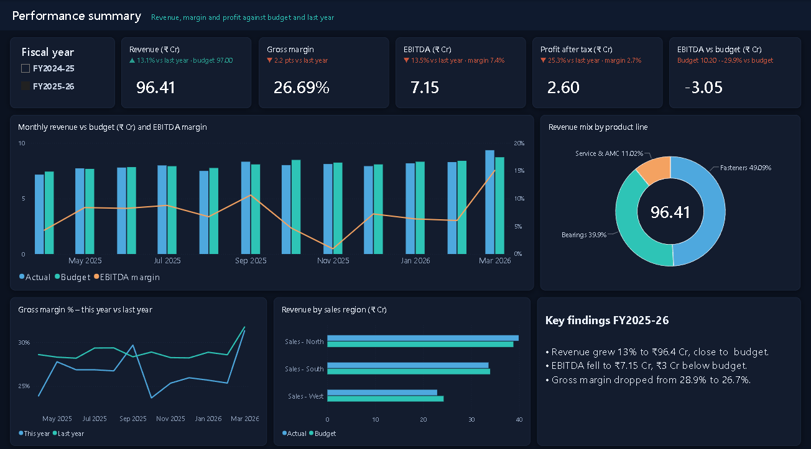
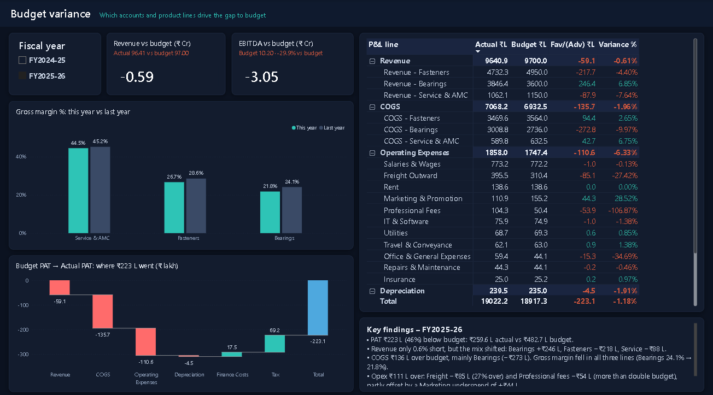
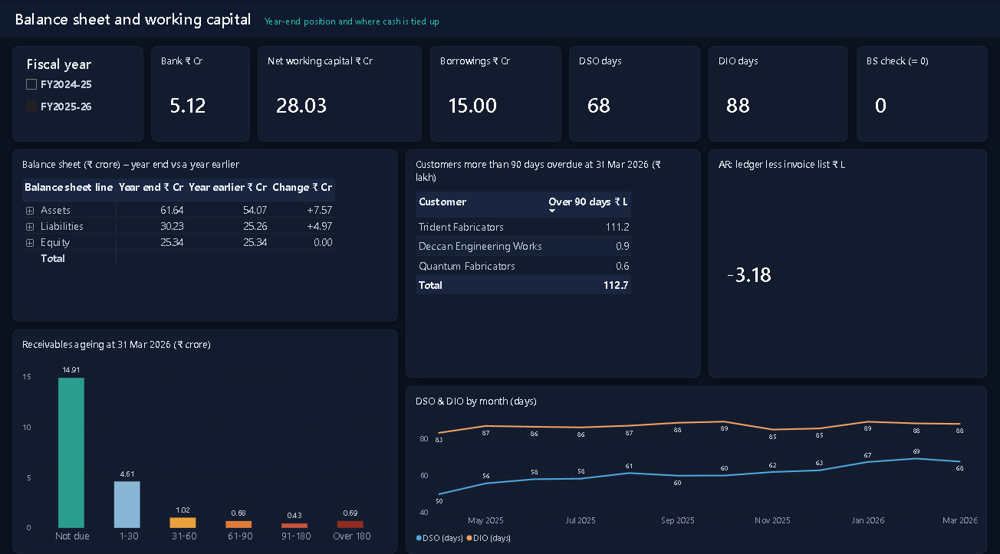
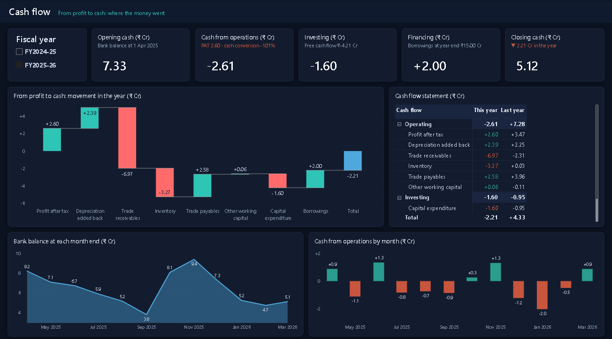
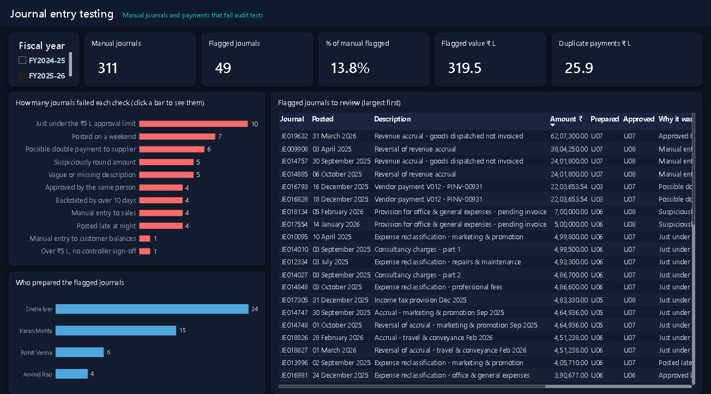

# General ledger analytics: financial performance and journal entry testing

A Power BI report built on a full double-entry general ledger. It answers the two questions a finance or audit team asks at year end: **why did profit miss budget**, and **which journals need a closer look**.

> The company, Northfield Industrial Supplies Pvt Ltd, is fictional and the ledger is synthetic. Real journal-level data is confidential, so the ledger is generated by a script in this repository. Control exceptions were planted in it deliberately, and the report's tests are checked against that list.



## What the report covers

| Page | Question it answers |
|---|---|
| Performance summary | How did revenue, margin and profit move against budget and prior year? |
| Budget variance | Which accounts and cost centres drive the variance? |
| Balance sheet and working capital | Does the balance sheet balance, and where is cash tied up? |
| Cash flow | How did profit turn into cash, and where did the cash go? |
| Journal entry testing | Which manual journals and payments fail audit tests? |
| Journal drill-through | What is the full double entry behind a flagged journal? |

## Findings for FY2025-26

**Performance**

- Revenue grew 13.1% to INR 96.41 crore, 0.6% short of budget, but EBITDA fell 13.5% to INR 7.15 crore against a budget of INR 10.20 crore.
- Gross margin fell from 28.9% to 26.7%. Bearings is the cause: its margin dropped from 24.1% to 20.6% in the second half while its sales ran 6.8% ahead of budget, so growth came from the least profitable line.
- Freight outward overran budget by INR 85 lakh (27%), rising from 3.3% to over 4% of revenue.
- Professional fees overran by INR 54 lakh, mostly a single unbudgeted advisory fee in November 2025.
- Marketing was underspent by INR 44 lakh, which masked part of the overruns.

**Working capital**

- Receivables rose from INR 15.35 crore to INR 22.32 crore and days sales outstanding from 52 to 68.
- One customer accounts for INR 1.11 crore of the INR 1.12 crore overdue by more than 90 days, with no provision booked.
- Inventory rose 22% against cost of sales growth of 17%.
- A working capital loan of INR 4 crore was drawn in October 2025 to fund the gap.

**Cash flow**

- Operations used INR 2.61 crore of cash in FY2025-26, against INR 7.28 crore generated the year before, although profit after tax was INR 2.60 crore.
- The swing is working capital: receivables absorbed INR 6.97 crore and inventory INR 3.27 crore, partly offset by INR 2.58 crore of longer supplier credit.
- After INR 1.60 crore of capital expenditure, free cash flow was minus INR 4.21 crore. The INR 4 crore working capital loan, net of INR 2 crore of term loan repaid, covered most of it, and the bank balance fell from INR 7.33 crore to INR 5.12 crore.

**Controls**

- Of 604 manual journals, 65 failed at least one of ten tests. Ten vendor payments form five possible duplicate pairs with INR 44 lakh at risk.
- A manual revenue accrual of INR 62 lakh was posted on 31 March 2026, prepared and approved by the same person, above their approval limit. It equals 24% of the year's profit after tax. Without it, revenue would be 1.2% short of budget.
- The same pattern appears at earlier period ends: revenue accruals posted on 31 March 2025 and 30 September 2025 were reversed within a week of the period closing. The 31 March 2026 accrual has not been reversed yet. This is a cut-off risk to test against delivery evidence.
- The receivables control account differs from the sub-ledger by INR 3,18,450, traced to one manual write-off posted directly to the control account.
- Ten round-sum provisions totalling INR 30 lakh were posted to office and general expenses over two years and never reversed. The INR 17 lakh posted in FY2025-26 exceeds that account's entire INR 15 lakh overrun.

## Screenshots

| | |
|---|---|
|  |  |
|  |  |

All six pages are also in [docs/GL_Analytics_report.pdf](docs/GL_Analytics_report.pdf). The report comes in two styles: dark navy (`GL_Analytics.pbip`, shown here) and light (`GL_Analytics_Light.pbip`, screenshots in [screenshots/light](screenshots/light) and [a PDF](docs/GL_Analytics_report_light.pdf)). Both open the same semantic model, so every figure is identical.

## How it is built

```
data/            10 CSV files: journal headers and lines, budget, receivables sub-ledger, dimensions
scripts/         generate_data.py (builds the ledger), validate.py (independent control totals),
                 build_*_page.py (write report pages 3-5 as PBIR files),
                 restyle_report.py (theme, layout, KPI cards and the cash flow page)
screenshots/     one image per page; docs/ holds the PDF
powerbi/         GL_Analytics.pbip (dark) and GL_Analytics_Light.pbip (light): one semantic model as TMDL,
                 two reports as PBIR,
                 plus power_query.m, measures.dax and theme.json
validation/      expected_results.md and the list of seeded exceptions
BUILD_GUIDE.md   step-by-step build instructions
```

- **Data model.** Header and line tables as in an ERP, with shared account, cost centre and date dimensions across actuals, budget and the receivables sub-ledger.
- **Power Query.** Type conversion, receivables ageing, and eleven journal tests, including a self-join that finds payments to the same vendor for the same amount within seven days.
- **DAX.** Profit and loss lines, sign-aware variance that works at any account level, fiscal year-to-date, closing balances, DSO and DIO, and a sub-ledger to general ledger reconciliation.
- **Cash flow.** An indirect cash flow statement built from the movement in every non-cash account, so it always reconciles to the bank account; a control measure proves the difference is zero.
- **Design.** One theme for the whole report, in a dark navy and a light version: rounded cards with a soft shadow, a header band on every page, and KPI cards whose notes turn green or red against last year or budget. `restyle_report.py --dark` builds the dark style.
- **Validation.** `validate.py` recalculates every reported figure in pandas from the raw files. The Power BI measures are checked against it.

### Journal tests

| Test | Rule |
|---|---|
| T1 | Manual journal entered on a Saturday or Sunday |
| T2 | Manual journal entered between 21:00 and 06:00 |
| T3 | Manual journal for an exact multiple of INR 1,00,000 |
| T4 | Manual journal within 10% below the INR 5,00,000 approval limit |
| T5 | Prepared and approved by the same user |
| T6 | Description blank or shorter than six characters |
| T7 | Entered more than 10 days after its posting date |
| T8 | At or above the approval limit without Financial Controller approval |
| T9 | Manual journal posted to a revenue account |
| T10 | Manual journal posted to the receivables control account |
| T11 | Payment to the same vendor for the same amount within seven days of another |

The tests found all 70 seeded journals and flagged five that were not seeded. Those five are genuine near-limit journals that an auditor would clear by enquiry, which is why a flag is a prompt for follow-up and not a finding.

## Reproduce it

```
pip install pandas numpy
python scripts/generate_data.py
python scripts/validate.py
```

The Power Query reads the CSV files from `C:\Users\Sammu\Documents\finance-gl-analytics\data`. After cloning to another folder, change that path in Power BI (Transform data > Data source settings) before refreshing.

The generator uses a fixed seed, so the files and control totals are identical on every run. Then follow [BUILD_GUIDE.md](BUILD_GUIDE.md).

## Use of AI

I built the report in two halves so that I could compare doing the work by hand with directing an AI agent to do it.

- **Pages 1 and 2 (Performance, Budget variance): by hand.** I loaded the data, built the star schema and relationships, wrote the profit and loss, budget and variance measures, and laid out every visual myself.
- **Pages 3 to 5 (Balance sheet, Journal testing, Journal detail): with Claude Code.** I saved the report as a Power BI project (`.pbip`), so the model and pages are plain text files. Claude Code worked on the open model through the [Power BI Modeling MCP server](https://github.com/microsoft/powerbi-modeling-mcp): it wrote the balance sheet, working capital, receivables and journal testing measures, the ageing columns and the `JournalFlags` query. Python scripts in `scripts/` write the page layouts as PBIR files and copy formatting from the hand-built pages so the report looks consistent.

I directed the work and checked it. I did not accept any figure on the agent's say-so:

- Every measure was queried with DAX and compared with `validation/expected_results.md`, which `validate.py` calculates independently in pandas from the raw files. A full audit of all five pages matched.
- The ledger is proven to balance journal by journal, and the journal tests are scored against a known answer key of seeded exceptions.
- The checks caught real problems: DAX variable names that clash with reserved function names, a card that went blank when a test bar was clicked (two filters with no overlap), and a receivables reconciliation difference that I traced to a single manual write-off.

I also used Claude to write the data generator and to draft the Power Query.

Later, Claude Code also redesigned the report and added the cash flow page. `restyle_report.py` applies one theme, re-grids every page, adds KPI cards with measure-driven notes, a revenue mix donut and a colour-graded ageing chart, and builds the cash flow page. The cash flow measures were checked the same way: `validate.py` recalculates every line in pandas, and both years match.

## Limitations

- Synthetic data is cleaner than a real ledger: no foreign currency, no intercompany entries, no TDS, and GST at a single rate.
- Receivables ageing is calculated as at the last date in the date selection. The slicer offers fiscal years only, so the report shows ageing at 31 March 2025 or 31 March 2026.
- The ledger has no year-end closing entry, so cumulative profit is shown as a separate line within equity.
- DPO uses cost of sales as a proxy for purchases and is an indicator only.
